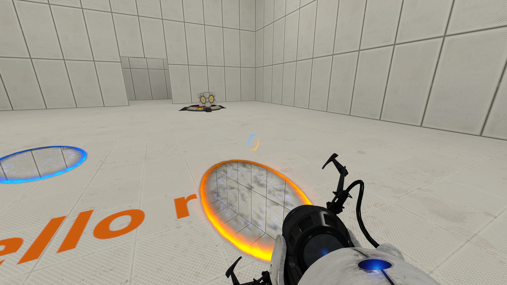

# Portal 2 地图生成预研 · 2026-11-25

[实验日志 · 2026-11-25](logs/2026-11-25.md)

今天用一间「方块压按钮开门」的测试室回答了两个问题：程序能否生成 Portal 2 接受的地图？编译通过后，还需要在游戏里验证什么？我们跑通了从描述生成地图的最小样例，并在另一张逐步扩建的测试室中验证了装备、传送门、机关和光照。正式设计与开发尚未开始。

## 讨论和实验经过

| 当时的问题 | 做了什么，得到什么结论 |
|---|---|
| 工坊地图从哪里来？ | 游戏内 Puzzle Maker 的拼图可导出为 VMF。Hammer 能打开 VMF。VBSP 展开实例、构建几何与碰撞，VVIS 计算可见性，VRAD 烘焙光照。原版游戏加载 BSP，工坊分发编译产物。 |
| AI 可以从哪一层介入？ | 用 JSON 写房间、组件和端口，再用 Python / srctools 生成 VMF。例如把 `plate.pressed → gate.open` 写成实体输出 `OnPressed → gate → Open`。小房间完成了三阶段编译，按钮与终点的连线也能从 BSP 读回。 |
| 如何让别人看到同一行橙色文字？ | 在地板上放置 `info_overlay`，让它引用自制的 `hello rex!` 材质。构建脚本用 BSPZIP 把 VMT、VTF 打进地图，随后核对了安装副本。 |
| 为什么地图能编译，玩家却看不到方块，也没有枪？ | 初版没有给方块指定模型，出生点也没有双传送枪。扩大房间后，明确配置方块模型和双发射模式的传送枪，地板及墙面采用原版可开传送门的白色面板，按钮改用原版嵌入式实例。 |
| 为什么按钮附近一片白？ | 在游戏里复现过曝，对照原版灯具补上距离衰减并重新烘焙。修复后面板纹理和橙字清晰可见；实机画面记录了地板上的蓝橙双门，以及方块压住按钮后打开的出口。 |

## 换电脑后先试什么

- **直接玩最终版。** 把 [foundry_button.bsp](foundry_button.bsp) 复制到 Steam 库的 `Portal 2/portal2/maps/`，进入游戏控制台执行 `map foundry_button`。最终大房间的可编辑源文件是 [foundry_button.vmf](foundry_button.vmf)。
- **复现描述生成。** 在本目录打开 PowerShell，按[构建说明](docs/portal2-map-build.md)安装依赖、运行生成器和官方编译器。[chamber.json](chamber.json) 与 [generate_vmf.py](generate_vmf.py) 对应较早的 `foundry_srctools` 小房间。仓库里的同名 VMF/BSP 是当时的快照；生成器后来补上了方块模型与灯光衰减。
- **回看实测。** [过曝复现](media/overexposed.jpg) · [修复后画面](media/lighting-fixed.jpg) · [当天分享长图](media/summary.png)。

## 留给下一轮 POC 的问题

希望让 LLM 通过 Python / srctools 直接表达布局、组件和事件，生成 VMF，再调用官方工具编译。Hammer 只用于检查生成结果的空间布局、组件朝向和 I/O。现有 JSON 是一次实验，后续可以用同一关卡比较不同描述方式。

原生组件已有样例。接入 BEE2 的下一步，是选一个带输入或输出的实际物品，在 Puzzle Maker 中构建最小样图，对照 BEE2 处理后的 VMF，核对实例、编译时生成的实体及资源依赖。工坊订阅、在线结算与投票也有待验证。

工具参考见 [Valve Authoring Tools](https://www.thinkwithportals.com/blog.php?id=5443&p=1)、[srctools VMF API](https://srctools.readthedocs.io/en/stable/modules/vmf.html) 和 [BEE2 物品包](https://github.com/BEEmod/BEE2-items)。
